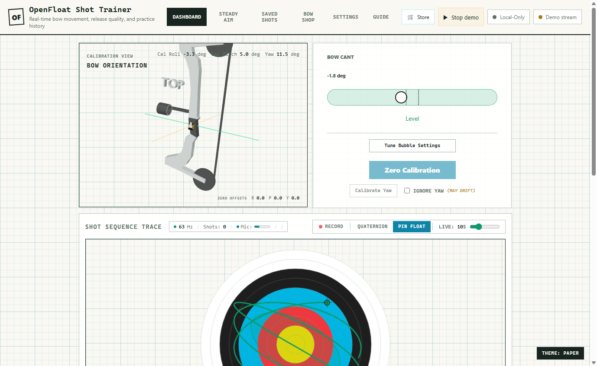

# Início rápido

Monte um sensor OpenFloat, grave o firmware e transmita dados de movimento ao
vivo para este aplicativo. Reserve cerca de uma hora para a primeira montagem;
a maior parte do tempo será instalar as ferramentas de firmware.

---

## Compatibilidade do navegador

### Navegadores compatíveis com o sensor ao vivo

| Navegador e plataforma | Conexão Bluetooth direta com o sensor |
| --- | --- |
| Chrome ou Edge no Windows ou macOS | Compatível |
| Chrome no Android ou ChromeOS | Compatível |
| Firefox ou Safari | Web Bluetooth indisponível |
| Safari, Chrome ou Edge no iPhone/iPad | Web Bluetooth indisponível |
| Chromium no Linux | Depende da plataforma; indisponível por padrão |

O suporte dos navegadores pode mudar. Consulte os [dados de compatibilidade do
Web Bluetooth](https://github.com/mdn/browser-compat-data/blob/main/api/Bluetooth.json)
e as [plataformas compatíveis com o Chrome](https://developer.chrome.com/docs/capabilities/bluetooth).
O aplicativo verifica a API Bluetooth disponível no navegador. Se o sensor não
puder ser acessado, um aviso explica o motivo e leva de volta a esta seção.

### Páginas seguras e servidor local

Abra o [OpenFloat por HTTPS](https://openfloatarchery.com) ou use
`http://localhost:4178` no computador que está servindo o aplicativo. Um
endereço HTTP comum na rede doméstica não oferece o contexto seguro exigido pelo
Bluetooth. O `localhost` de um celular se refere ao próprio celular. Consulte
[contextos seguros](https://developer.mozilla.org/en-US/docs/Web/Security/Defenses/Secure_Contexts).

Abra o aplicativo diretamente em uma aba caso uma página incorporada bloqueie o
Bluetooth. Ative o Bluetooth do computador ou celular, desperte o sensor e
selecione-o na janela do navegador. O suporte do navegador, por si só, não
confirma que o rádio ou o sensor estejam prontos.

### Demo e dados salvos

Demo, Disparos salvos e backup/restauração local funcionam sem Web Bluetooth.
Experimente o botão **Demo** no cabeçalho ou importe uma captura JSON existente
em Configurações. A verificação de suporte do sensor não apaga gravações nem
interrompe uma demo em andamento. Instalar o site como aplicativo mantém os
requisitos de Bluetooth do mesmo navegador.

---

## 1. O que você precisa

**Hardware**

- **Seeed Studio XIAO nRF54L15 Sense** — microcontrolador, BLE, IMU integrada
  (`LSM6DS3TR-C`) e microfone PDM. É o cérebro completo do dispositivo.
- **Bateria LiPo de 3,7 V**, cerca de 70 mAh, com circuito de proteção, para uso
  no estande sem cabo. (Durante a preparação, também é possível usar USB.)
- **Massa adesiva de montagem** — uma pequena porção de massa removível basta
  para fixar a placa ao arco. Repetir a montagem da mesma forma melhora os dados.
- **Cabo USB-C** para conectar o XIAO ao computador e gravar o firmware.

**Software**

- Um **navegador Chromium** (Chrome ou Edge): Web Bluetooth é necessário e não
  está disponível no Firefox nem no Safari.
- A cadeia de ferramentas **nRF Connect SDK (NCS) v3.3.0** para compilar o
  firmware. O suporte à placa XIAO nRF54L15 já vem no NCS v3.3.0; não é preciso
  instalar um pacote externo de placas.
- **OpenOCD** para gravar a compilação pela interface de depuração CMSIS-DAP.

> A cadeia de ferramentas do firmware só precisa ser instalada uma vez. Depois,
> a regravação se resume a dois comandos.

---

## 2. Montar o hardware

1. Solde os fios da bateria (ou um conector JST) nos terminais `BAT+` / `BAT-`
   do XIAO, respeitando a polaridade. Pule esta etapa se for usar apenas USB.
2. Pressione uma pequena porção de massa adesiva no arco e fixe a placa com
   firmeza, sem folgas — qualquer movimento ou vibração aparece como ruído no
   traçado. Verifique se a fixação é firme o bastante para que a placa **não
   possa se soltar como um projétil** nem interferir com o arco no disparo.
3. Anote a orientação da placa no arco. Depois você poderá alinhá-la pelo
   mapeamento de eixos no aplicativo e pelo botão **Zerar calibração**; ela não
   precisa ficar perfeitamente alinhada mecanicamente.

> **Segurança:** OpenFloat é um projeto experimental, para hobby e educação, e
> não é um dispositivo de segurança. Siga sempre as regras normais de segurança
> do estande.

---

## 3. Compilar o firmware

> **Pule esta etapa** baixando o `merged.hex` pré-compilado da
> [versão mais recente no GitHub](https://github.com/DevanMetz/Open-Float-Archery/releases/latest)
> — a CI o compila a partir do código marcado. Você ainda precisa do OpenOCD
> para gravar o firmware (etapa 4), mas não da cadeia de ferramentas NCS.

O firmware fica em `firmware/` e usa o alvo
`xiao_nrf54l15/nrf54l15/cpuapp`. Compile com a cadeia de ferramentas NCS v3.3.0.
Em uma instalação típica do Windows, o comando testado é:

```powershell
& "C:\ncs\toolchains\b8b84efebd\nrfutil\bin\nrfutil.exe" toolchain-manager launch `
  --ncs-version v3.3.0 `
  --chdir "C:\ncs\v3.3.0" `
  -- west build `
  -p always `
  -b xiao_nrf54l15/nrf54l15/cpuapp `
  -d "firmware\build-v3.3.0" `
  "firmware"
```

Uma compilação bem-sucedida gera:

```text
firmware/build-v3.3.0/merged.hex
```

A configuração padrão é **segura para bateria**: desativa o console USB UART
para que a placa inicialize com a bateria LiPo. Para ver logs seriais na bancada,
adicione o overlay USB:

```powershell
-DOVERLAY_CONFIG=prj_uart.conf
```

> Estes dois avisos são esperados e inofensivos:
> `SB_CONFIG_PARTITION_MANAGER ... deprecated` e
> `BT_HCI_TX_STACK_SIZE was assigned 2048 but got 1536`.

Para ver o guia completo de compilação, gravação e verificação — incluindo o
overlay serial USB e as opções de ajuste — consulte
[firmware/BUILDING.md](../../firmware/BUILDING.md).

---

## 4. Gravar o firmware

Conecte o XIAO por USB e grave o `merged.hex` com OpenOCD, usando a interface
CMSIS-DAP da placa:

```powershell
openocd `
  -s "<seeed-support>/boards/arm/xiao_nrf54l15/support" `
  -s "C:/Program Files/OpenOCD/share/openocd/scripts" `
  -c "adapter serial <YOUR_PROBE_SERIAL>" `
  -f "<seeed-support>/boards/arm/xiao_nrf54l15/support/openocd.cfg" `
  -c "init" `
  -c "reset init" `
  -c "nrf54l-load firmware/build-v3.3.0/merged.hex" `
  -c "verify_image firmware/build-v3.3.0/merged.hex" `
  -c "reset run" `
  -c "shutdown"
```

Substitua `<YOUR_PROBE_SERIAL>` pelo número de série CMSIS-DAP da interface de
depuração e `<seeed-support>` pelo caminho dos arquivos de suporte da Seeed. Ao
terminar, a placa reinicia e executa imediatamente o novo firmware.

---

## 5. Confirmar o funcionamento

Depois da gravação, o firmware anuncia o dispositivo BLE como **`OpenFloat-XXXX`**
e pisca o LED de usuário. O sensor está pronto para o aplicativo web.

Se você compilou com o overlay USB UART, também pode confirmar a inicialização
pela serial a **115200 baud**. Abra a porta com DTR/RTS ativados e reinicie a
placa; você deverá ver:

```text
*** Booting nRF Connect SDK v3.3.0 ***
# OPENFLOAT_PROTO,1
# target: Seeed XIAO nRF54L15 Sense
# imu_odr_hz: 3332
# IMU ready: ... accel+gyro ODR 3332 Hz ...
OFRAW,1,0,77728,900, ...
```

Um dispositivo funcionando transmite cerca de 1110 quadros médios por segundo,
sem estouros FIFO.

---

## 6. Abrir o aplicativo web

Sirva a raiz do repositório em `localhost` (módulos ES nativos precisam de uma
origem HTTP; Web Bluetooth também exige HTTPS ou uma origem local confiável):

```powershell
python -m http.server 4178
```

Depois, abra **http://localhost:4178/** no Chrome ou Edge. O aplicativo também
funciona totalmente offline após o carregamento, e a versão hospedada está em
`openfloatarchery.com`.

---

## 7. Conectar via Bluetooth

1. Ligue o sensor (com bateria ou USB) e mova-o para despertá-lo.
2. No cabeçalho do aplicativo, ative o botão do sensor **Desconectado**, no
   canto superior direito. Também funciona com Tab seguido de Enter ou Espaço.
3. Na janela Bluetooth do navegador, selecione e pareie o dispositivo
   **`OpenFloat-XXXX`**.
4. O indicador fica verde e o Painel começa a transmitir: o visualizador de
   orientação do arco se move, o Traçado do disparo é preenchido e a taxa ao vivo
   mostra cerca de 1110 Hz.

Se a conexão cair, o aplicativo tenta reconectar automaticamente (até seis
vezes, com intervalos crescentes) e o firmware volta a anunciar o sensor —
geralmente a conexão retorna sozinha.



> Ainda sem sensor? O botão **▶ Demo** no cabeçalho transmite movimento
> simulado para você explorar o Painel.

---

## 8. Primeira calibração

1. Segure o arco nivelado, na posição em que costuma atirar.
2. No Painel, clique em **Zerar calibração** para salvar os valores atuais de roll
   e pitch como referência de nível. A bolha e o arco 3D deverão aparecer
   nivelados.
3. Se o arco na tela estiver girado em relação à montagem real, abra
   **Configurações → Alinhamento do sensor e 3D** e ajuste o mapeamento dos eixos
   até o modelo corresponder à realidade.

Pronto — faça um disparo e ele aparecerá em **Disparos recentes** com uma
pontuação OpenFloat Float Score. Depois, explore **Mira Estável** para treinar a
sustentação e **Disparos salvos** para revisar a sessão.

## 9. Escolher o idioma, ajustar o contador e usar o OBS

Abra **Configurações → Preferências** e escolha **English (United States)** ou
**Português (Brasil)**. A escolha fica salva neste perfil do navegador e é
compartilhada com overlays do OBS abertos na mesma origem.

O contador do Painel tem os botões **−**, **+** e **Zerar**. Eles corrigem o
valor exibido neste navegador; não apagam disparos salvos nem enviam um comando
de zeragem ao sensor. O ajuste é salvo localmente. Zerar o contador exibido é
diferente de restaurar as configurações de fábrica; a restauração também mantém
o contador.

Para adicionar uma visualização ao OBS Studio:

1. Abra **Configurações → Sobreposição do OBS Studio** e escolha uma opção:
   **Contador de disparos**, **Alvo Pin Float**, **Métricas do último disparo**
   ou **Resumo da sessão**.
2. Copie a **URL da Fonte de Navegador** gerada. Cada opção tem uma URL própria
   (`?overlay=counter`, `?overlay=target`, `?overlay=metrics` ou
   `?overlay=review`); use o link mostrado nas Configurações.
3. No OBS, adicione uma **Fonte de Navegador** e cole a URL. Para receber dados
   ao vivo, mantenha o Painel e a fonte do OBS na mesma origem e no mesmo perfil
   do navegador.
4. Nas Configurações, escolha fonte, tamanho (14–40 px), cores do texto/fundo/
   destaque e quantidade prevista de disparos (0–999). As alterações ficam
   salvas no navegador e atualizam o overlay.

O overlay de contador mostra disparos reais e previstos; o de alvo mostra o
traçado Pin Float mais recente; o de métricas mostra o último disparo; e o de
revisão resume a sessão atual. Para contribuir com idiomas, consulte o
[Guia de tradução](../translation-guide.md).
